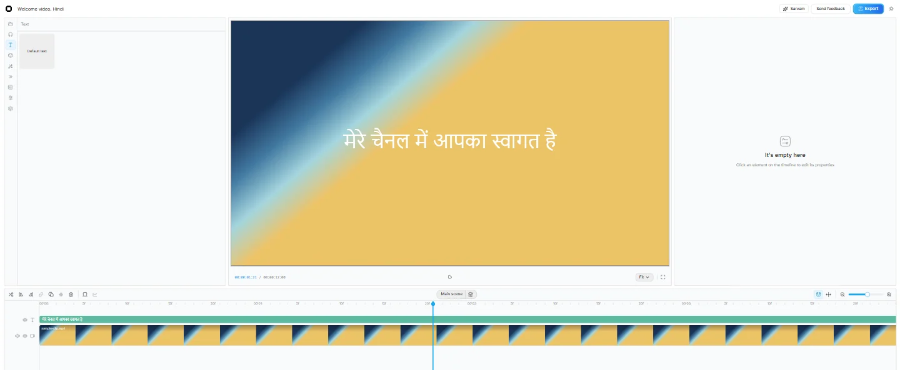

<h1 align="center">Sarvam Editor</h1>

<p align="center"><strong>Edit once, publish in many Indian languages.</strong></p>

<p align="center">
An open-source browser video editor for Indian creators, built on OpenCut Classic. Sarvam AI writes
the captions, translates them and voices them, and an agent can drive the editor through Sarvam-105B
function calling or MCP.
</p>

<p align="center">
  <a href="https://boss477.github.io/sarvam-editor/"></a>
  <a href="LICENSE"></a>
  
  
  
</p>



<sub>Captured from a local run. The clip is a generated test pattern; the title reads "Welcome to my channel" in Hindi.</sub>

> **Independent community project.** Not an official Sarvam AI product, and not affiliated with or
> endorsed by Sarvam AI or OpenCut. Previously developed locally as Bharat Editor.

## What it does

| | What happens |
|---|---|
| **Edit** | A browser timeline with split, trim, undo and redo. Projects stay in browser storage. |
| **Caption** | Timestamped, editable captions from Sarvam speech-to-text. |
| **Translate and voice** | Caption translation across 23 language codes, and caption-aligned speech in the 11 Bulbul v3 languages. |
| **Title** | Editable lower-third, rising and pop motion titles, in twelve self-hosted Indic font families. |
| **Export** | A video and an SRT file per language, packaged in one ZIP. |
| **Automate** | A Sarvam-105B assistant and a shared 14-tool MCP bridge drive the same editor actions. |

## Quick Start

Requires [Bun](https://bun.sh/) and a modern browser with media codec support.

```powershell
git clone https://github.com/boss477/sarvam-editor.git
cd sarvam-editor
Copy-Item apps/web/.env.example apps/web/.env.local
bun install
cd apps/web
bun run dev --port 3015
```

Open [localhost:3015](http://localhost:3015). Set `NEXT_PUBLIC_SITE_URL` to that
address in the local environment file. Generate independent random values for
`BETTER_AUTH_SECRET` and `EDITOR_AGENT_TOKEN`; do not deploy example credentials.

Ordinary editing and local export do not need an AI API key. For AI features,
set server-only `SARVAM_API_KEY` in `apps/web/.env.local` and restart the server.
The app integrates speech-to-text, translation, text-to-speech and chat APIs.
Claude is optional; the built-in Sarvam assistant does not require Claude login.

Project media stays in browser storage during ordinary editing. AI operations
send the required audio/text and assistant tool context to Sarvam. Keep this
development setup local; production authentication/deployment are not verified.

## Status and Documentation

This is a working development prototype, not a production-ready release.
Local editing, persistence, MCP actions and synthetic media exports were tested.
Live authenticated Sarvam workflows and speech quality remain unverified.
Caption/translation controls expose 23 language codes; Bulbul v3 voice generation
is limited to 11 languages. No voice cloning or lip-sync is implemented.

The focused integration suite has 39 passing tests. The last full web suite had
231 passing tests and three existing upstream mask-test failures.

- [Setup, MCP, tests and verified limitations](BHARAT.md)
- [Milestones](docs/bharat-milestones.md)
- [Editor reference study](docs/editor-references.md)
- [Motion engine licensing review](docs/motion-engines.md)

## Attribution and License

Based on [OpenCut Classic](https://github.com/OpenCut-app/opencut-classic), commit
`cf5e79e919144200294fb9fed22a222592a0aeea`. The original MIT license and notices
are retained in [LICENSE](LICENSE). Bundled fonts include their OFL notices under
`apps/web/public/licenses/`. Sarvam API use is subject to the provider's terms
and pricing. No Remotion, GSAP or HyperFrames rendering runtime is bundled.

The original upstream README follows for architecture and development reference.
Its sponsorship and roadmap statements describe upstream, not this project.

---

# OpenCut (Legacy)

This is the original OpenCut codebase. It's archived and no longer maintained.

The rewrite is happening at [opencut-app/opencut](https://github.com/opencut-app/opencut).

## Sponsors

Thanks to [Vercel](https://vercel.com?utm_source=github-opencut&utm_campaign=oss) and [fal.ai](https://fal.ai?utm_source=github-opencut&utm_campaign=oss) for their support of open-source software.

<a href="https://vercel.com/oss">
  
</a>

<a href="https://fal.ai">
  
</a>

## Why?

- **Privacy**: Your videos stay on your device
- **Free features**: Most basic CapCut features are now paywalled 
- **Simple**: People want editors that are easy to use - CapCut proved that

## Project Structure

- `apps/web/`: Next.js web application
- `apps/desktop/`: Native desktop app built with GPUI (in progress)
- `rust/`: Platform-agnostic core: GPU compositor, effects, masks, and WASM bindings. We're actively migrating business logic here from TypeScript.
- `docs/`: Architecture and subsystem documentation

## Getting Started

### Prerequisites

- [Bun](https://bun.sh/docs/installation)
- [Docker](https://docs.docker.com/get-docker/) and [Docker Compose](https://docs.docker.com/compose/install/)

> **Note:** Docker is optional but recommended for running the local database and Redis. If you only want to work on frontend features, you can skip it.

### Setup

1. Fork and clone the repository

2. Copy the environment file:

   ```bash
   # Unix/Linux/Mac
   cp apps/web/.env.example apps/web/.env.local

   # Windows PowerShell
   Copy-Item apps/web/.env.example apps/web/.env.local
   ```

3. Start the database and Redis:

   ```bash
   docker compose up -d db redis serverless-redis-http
   ```

4. Install dependencies and start the dev server:

   ```bash
   bun install
   bun dev:web
   ```

The application will be available at [http://localhost:3000](http://localhost:3000).

The `.env.example` has sensible defaults that match the Docker Compose config — it should work out of the box.

### Desktop setup

Desktop is opt-in. If you're only working on the web app, skip this entirely.

If you want to get ready for `apps/desktop`, see [`apps/desktop/README.md`](apps/desktop/README.md). It's a two-step setup: Rust toolchain first, then desktop native dependencies.

### Local WASM development

Only needed if you're editing `rust/wasm` and want the web app to use your local build instead of the published package.

**Prerequisites** — install these once before anything else:

```bash
# Rust toolchain
curl --proto '=https' --tlsv1.2 -sSf https://sh.rustup.rs | sh

# build the WASM package
cargo install wasm-pack

# reruns the build on file changes, used by bun dev:wasm
cargo install cargo-watch
```

1. Build the package once from the repo root:

   ```bash
   bun run build:wasm
   ```

2. Register the generated package for linking:

   ```bash
   cd rust/wasm/pkg
   bun link
   ```

3. Link `apps/web` to the local package:

   ```bash
   cd apps/web
   bun link opencut-wasm
   ```

4. Rebuild on changes while you work:

   ```bash
   bun dev:wasm
   ```

To switch `apps/web` back to the published package, run:

```bash
cd apps/web
bun add opencut-wasm
```

### Self-Hosting with Docker

To run everything (including a production build of the app) in Docker:

```bash
docker compose up -d
```

The app will be available at [http://localhost:3100](http://localhost:3100).

## Contributing

We welcome contributions! While we're actively developing and refactoring certain areas, there are plenty of opportunities to contribute effectively.

**🎯 Focus areas:** Timeline functionality, project management, performance, bug fixes, and UI improvements outside the preview panel.

**⚠️ Avoid for now:** Preview panel enhancements (fonts, stickers, effects) and export functionality - we're refactoring these with a new binary rendering approach.

See our [Contributing Guide](.github/CONTRIBUTING.md) for detailed setup instructions, development guidelines, and complete focus area guidance.

**Quick start for contributors:**

- Fork the repo and clone locally
- Follow the setup instructions in CONTRIBUTING.md
- Working on `apps/desktop`? See [`apps/desktop/README.md`](apps/desktop/README.md) for setup
- Create a feature branch and submit a PR

## License

[MIT LICENSE](LICENSE)

---


